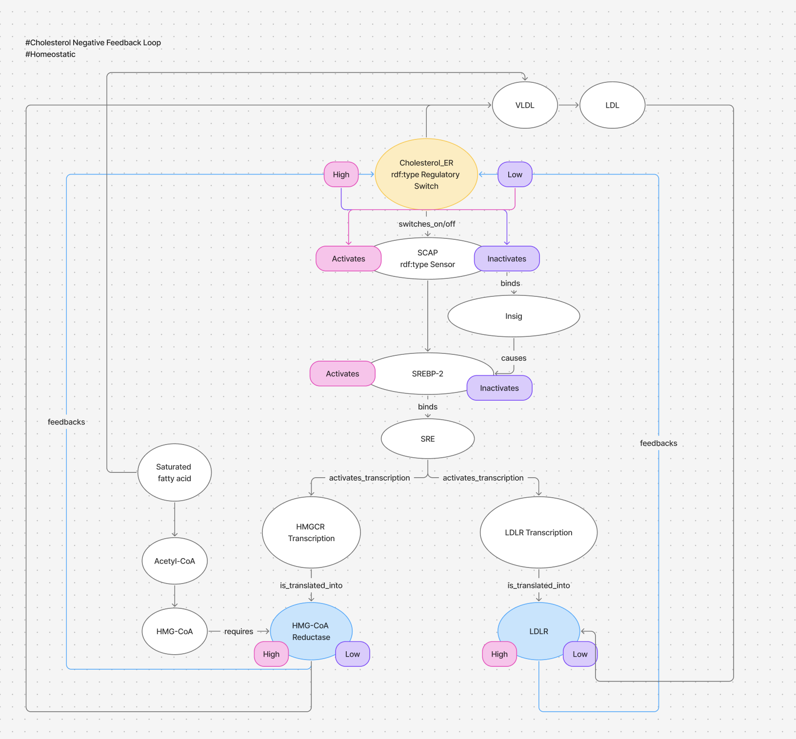
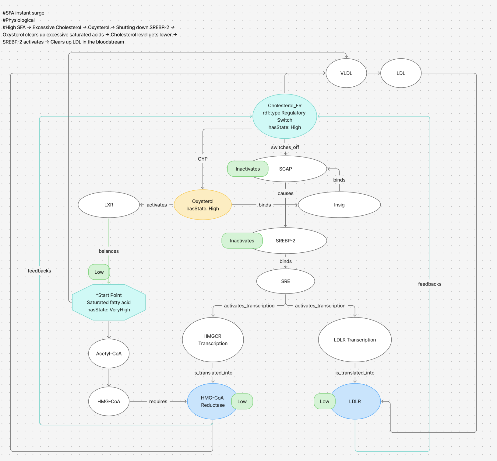
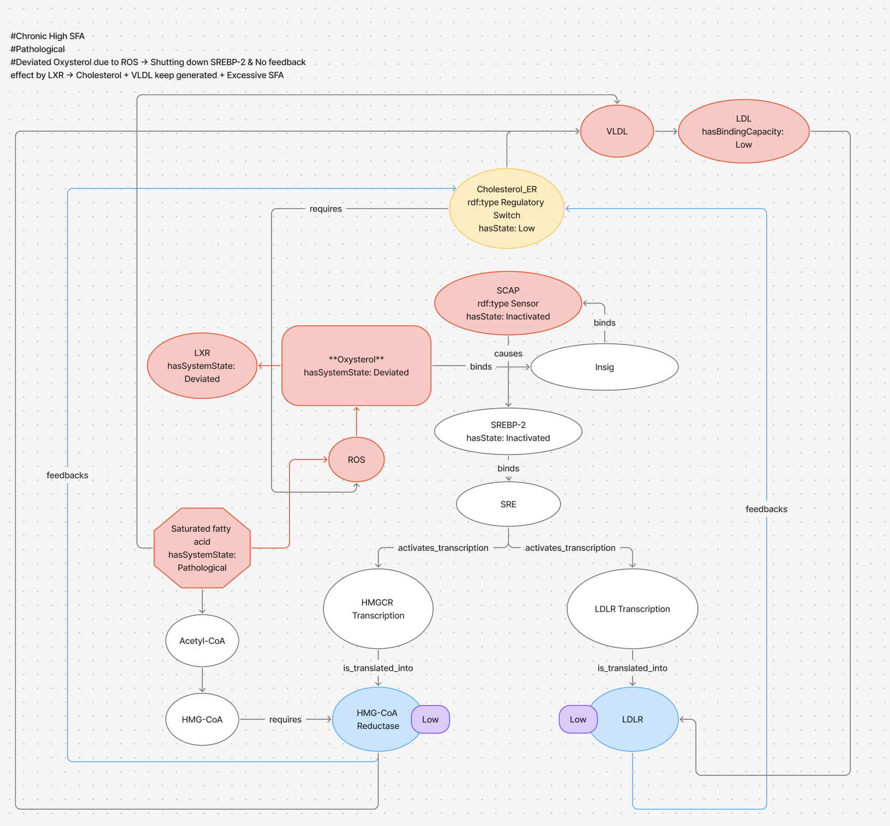
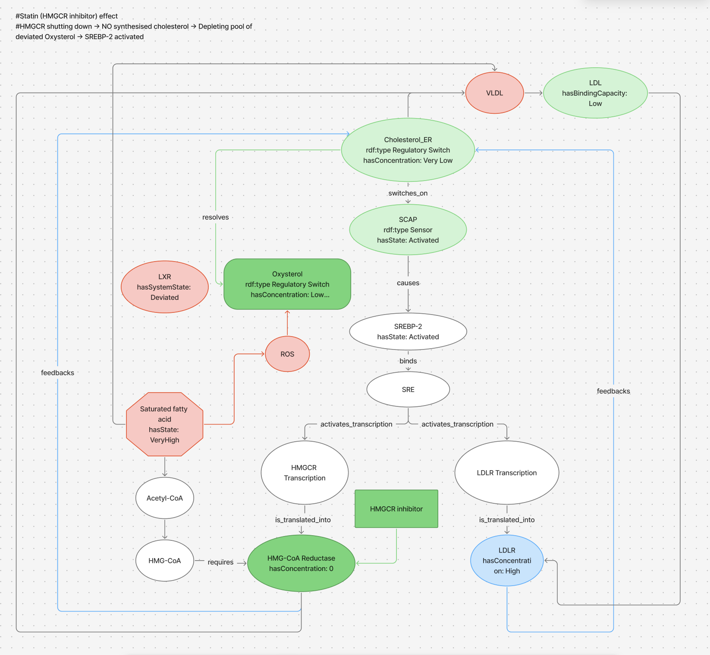

# The Four-State Model

This document introduces the state-based modelling approach developed in Forest OS to explore how context-dependent biological behaviourt can be represented within an OWL-based ontology. 

A central modelling challenge is **how to preserve shared biological knowledge without unnecessary duplication**, while representing differences in biological regulation across homeostatic, physiological, pathological and pharmacologically modified contexts. Rather than constructing entirely separate biological model for each sate, the approach maintains a shared class-level structure (TBox) and introduces state-specific individuals and assertions where meaningful biological differences need to be represented. 

This approach is intended to make **context-dependent relationships queryable**, particularly changes associated with pathological disruption and pharmacological intervention, including mechanisms modified by treatment and underlying pathological processes that may remain unresolved. 

It expands on the `Biomedical_Layer` from conceptual framework introduced in the main README, providing state-specific diagrams, biomedical case studies and SPARQL queries that examine how these relationships are represented in the current RDF graph.

The four states are comparative snapshots rather than a simulation of biological processes over time. 

---

## The States, Briefly
The four states provide comparative snapshots of biological regulation under different conditions. They share an underlying biological framework, while allowing context-specific mechanisms and relationhips to be represented where relevant. 

| State | Name | Loop | What's happening |
|---|---|---|---|
| 0 | Homeostatic | Closed | Baseline regulation, where biological mechanism maintain a relatively stable internal environment through ongoing regulatory processes. |
| 1 | Physiological | Closed | A response to a perturbation in which regulated mechanisms remain capable of resolving the deviation and supporting a return towards homeostasis |
| 2 | Pathological | **Blocked** | A condition in which regulatory mechanisms are disrupted or insufficient, allowing pathological processes or deviations to persist. |
| 3 | Pharmacological | Closed (externally) | A drug-modified condition in which selected biological mechanisms are altered, potentially improving downstream outcomes while some underlying pathological processes remain unresolved. |

Importantly, the pharmacological state does not necessarily represent a return to homoestasis. The model is intended to distinguish between mechanisms modified by treatment and those that may remain pathologically altered. 

---

## Case Study: Hypercholesterolaemia

### State 0 — Homeostatic

Cholesterol_ER (Regulatory_Switch) drops → Switches on SCAP (Sensor)  → 
SCAP (Sensor) activates SREBP-2 → HMGCR/LDLR transcription rises → VLDL increases/LDL cleared → 
Cholesterol_ER restored.

Cholesterol_ER High → Switches off SCAP (Sensor) → Binds Insig → Inactivates SREBP-2
→ HMGCR/LDLR transcription drops → VLDL/Cholesterol_ER decreases → Cholesterol_ER restored.



### State 1 — Physiological

Saturated fat surge → Oxysterol rises → SREBP-2 transiently shut down 
→ HMGCR/LDLR transcription drops → Normal Oxysterol activates LXR → 
SFA cleared via LXR → Oxysterol falls → SREBP-2 reactivates → LDL cleared.

Two-phase resolution, but it resolves — LXR is the balancing mechanism that
closes the loop.



### State 2 — Pathological

Chronic high SFA → ROS-driven Oxysterol → overrides SREBP-2 via Insig regardless of
what SCAP correctly senses (false trigger). LXR's balancing response no
longer clears the deviation (ROS-driven Oxysterol cannot activate LXR normally) 
— VLDL and cholesterol keep being generated by baseline activity of HMGCR. Due to low LDLR transcription, LDL remains in the bloodstream. 



### State 3 — Pharmacological

Statin inhibits HMG-CoA Reductase directly, depleting the cholesterol pool
that feeds ROS-driven Oxysterol. SREBP-2 reactivates and LDL clears — without ROS or
SFA ever being addressed. The drug closes the LDL loop; the root cause
(chronic SFA / ROS) remains open.



---

## SPARQL Exploration of State-Specific Relationships
The following SPARQL queries were developed to explore how state-dependent biological relationships are represented in the current RDF graph. They examine differences between physiological, pathological and pharmacologically modified contexts, particularly the representation of regulatory divergence and potentially unresolved pathological mechanisms.

**Which pathological nodes have no pharmacological resolution?**
(`sparql/pathological_resolution_status.rq`)

In the current asserted graph, Saturated_Fatty_Acid, Reactive_Oxygen_Species and Liver_X_Receptor are returned with the query-defined status "Unresolved", as the query does not identify a corresponding pharmacological resolution relationship for these components.

By contrast, the model represents statin-associated changes involving Oxysterol and LDL. This distinction is intended to illustrate how the ontology can differentiate mechanisms affected by treatment from pathological processes that are not represented as resolved.

However, an "Unresolved" query result indicates the absence of a qualifying relationship under the current query criteria, rather than proving that the biological mechanism cannot be resolved.

**How do represented regulatory relationships differ between physiological and pathological contexts?**
(sparql/physio_vs_patho_divergence.rq)

LX_Receptor (LXR) provides an illustrative example. In the current model, its State 1 (physiological) individual has an asserted balances_to relationship, whereas the corresponding State 2 (pathological) individual does not.

This difference illustrates how state-specific individuals can be used to represent regulatory divergence while retaining a shared class-level structure.

The absence of a balances_to assertion in State 2 should not, on its own, be interpreted as proof that the corresponding biological relationship is impossible or definitively absent.


Full query definitions and result tables: [`sparql/README.md`](../sparql/README.md).

---

## Reference Case: Myocardial Infarction

MI was the first disease mapped and remains useful as a comparison case —
it shows the same 4-state pattern with two simultaneous corruptions.

```
HEALTHY RESPONSE:
  Injury → endothelial damage → collagen/vWF exposure + temporary
  NO/PGI2/CD39 suppression → platelet activation → clot → haemostasis →
  repair → regulators restored. Loop closed.

MI DEVIATION — two simultaneous corruptions:
  Corruption 1 (false trigger):
    Plaque rupture --mimics--> injury signal. Collagen/vWF exposed, no
    actual wound.
  Corruption 2 (broken brake):
    Atherosclerosis --chronically suppresses--> endothelial function.
    NO/PGI2/CD39 absent, platelet activation unchecked.
  → Blood clot in coronary artery → Vascular blockage → ischaemia → no repair
  target, no resolution.
  Corruption 3 (feedback loop):
    Ischaemia --mimics--> Hypoxia → SNS unregulated → heart rate/
    vasoconstriction --deviates_into--> Ischaemia.
```

| Drug | Mechanism | Corruption targeted |
|---|---|---|
| Bisoprolol | Binds beta1 receptors | Lowers oxygen demand via heart rate |
| Statin | Inhibits HMG-CoA reductase | Prevents Corruption 1 (false trigger) |
| Aspirin | COX-1 inhibition → ↓TXA2 | Dampens amplification within deviation |
